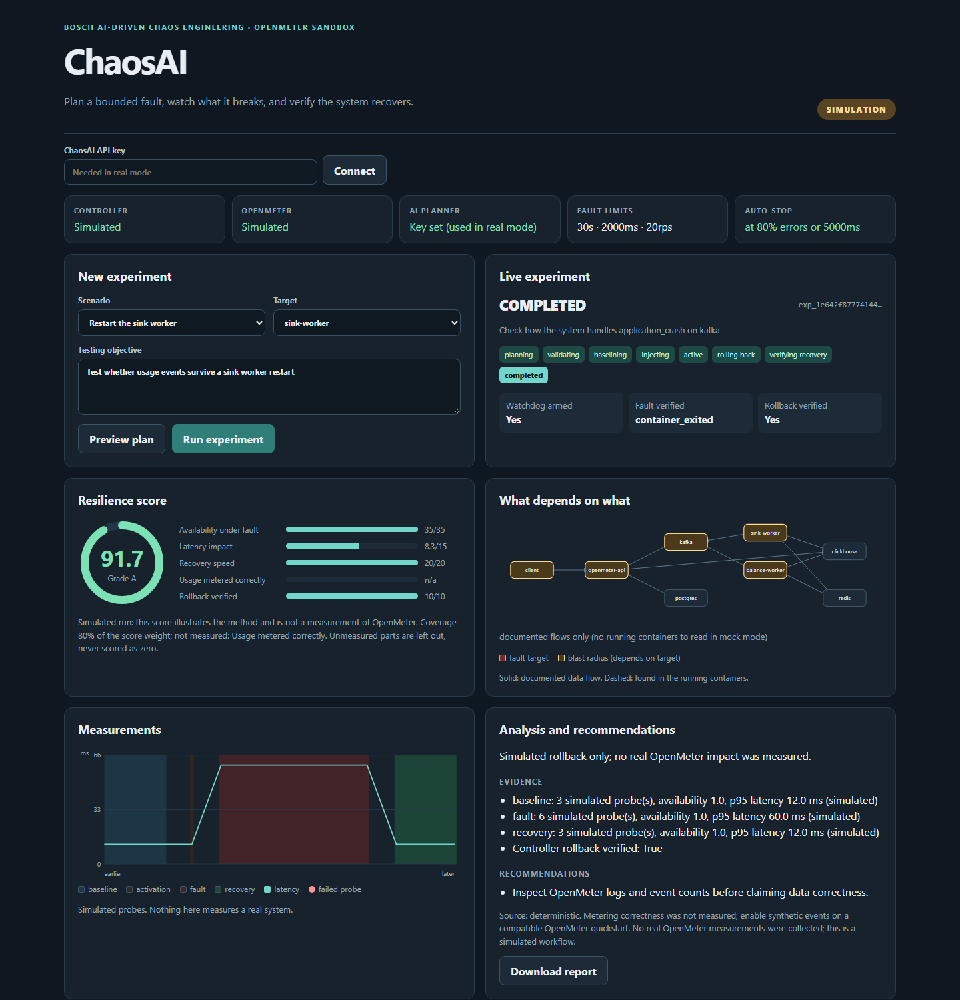

# ChaosAI: an AI that breaks OpenMeter safely, then tells you what it learned

ChaosAI plans a bounded failure experiment against a sample cloud-native app (OpenMeter, running in your own Docker sandbox), injects it through a separate controller that always rolls back, measures what really happened, and explains it.

Built for the Bosch AI-Driven Chaos Engineering challenge. **Sandbox only: ChaosAI never touches production or anyone else's systems.**



*The dashboard in mock mode: a completed run with its resilience score, dependency map, measurements and analysis. Real-mode results are in the table below.*

## Run it (about 5 minutes, needs Docker Desktop)

```bash
cp .env.example .env
docker compose up --build
```

Open <http://localhost:5173>. This is **mock mode**: the whole workflow runs with clearly labelled simulated faults and measurements. Nothing is injected.

## Run it for real (OpenMeter + real faults)

1. In `.env` set `CHAOS_CONTROL_API_KEY` and `CHAOSAI_API_KEY` to random strings. Optionally set `NVIDIA_API_KEY` to let an LLM plan and diagnose.
2. Start everything (first start pulls about 5 GB of images, so do it on a good connection; later starts take about a minute):

```bash
docker compose -f docker-compose.yml -f docker-compose.real.yml up --build
```

3. Open <http://localhost:5173>, paste `CHAOSAI_API_KEY` into the key field, and click connect. The panel should show OpenMeter and the controller as reachable.
4. Real injections are off by default. Set `REAL_INJECTIONS_ENABLED=true` in `.env` and re-run the command above, then start an experiment.

## What happens in one experiment

```
goal -> Planner (NVIDIA LLM) -> safety checks -> baseline probes
     -> Chaos Control injects a fault (watchdog armed first) -> Observer measures
     -> verified rollback -> recovery check (is usage still metered correctly?)
     -> Analyzer (NVIDIA LLM, cites measured evidence) -> report in the dashboard
```

| Piece | Where | Role |
|---|---|---|
| Sample app | `sample-app/`, `docker-compose.real.yml` | OpenMeter (Apache-2.0) with Kafka, ClickHouse, Postgres, Redis |
| Orchestrator, Planner, safety, API | `backend/chaosai/` | LangGraph workflow, FastAPI |
| Observer and Analyzer | `backend/chaosai/insight/` | Latency, errors, metering correctness, recovery time; evidence-cited diagnosis |
| Chaos Control | `controller/` | The only component with Docker access. Allowlisted faults, own watchdog, verified rollback |
| Dashboard | `frontend/` | React UI |

Faults: container crash, service restart, network latency (via Toxiproxy), traffic spike (bounded load generator), and failed dependencies (stop Kafka, ClickHouse, Redis or Postgres). An automatic stop fires when error rate or latency crosses a threshold, and every run gets a resilience score.

## Results from real runs

Measured against a live OpenMeter stack (12 Docker containers) on one laptop. These are demonstrations that the system works, not a statistical benchmark; each window used 2 to 10 probes.

| Fault | What we measured |
|---|---|
| Network latency (500 ms) | Probe p95 14.6 ms to 528 ms, back to 9.8 ms after rollback |
| Traffic spike (15 events/s for 10 s) | 150 of 150 events accepted and found in the meter; p95 11.6 ms to 27.1 ms |
| Container crash | Availability 100%, 0%, 100%; detected in 3.7 s; rollback verified |
| Crash with automatic stop | Stop fired at 100% error rate, controller aborted, rollback and recovery verified |
| Kill switch | Abort during an active fault completed in about 4 s, rollback verified |
| Kafka stopped | Run 1 recovered and metered all events. Run 2 was reported as `RECOVERY_FAILED` because 2 accepted events were never metered. After the late-metering fix, run 3 completed with 3 of 3 events metered (score 78.8). We report the failure instead of hiding it |

Full table and caveats: [docs/PRESENTATION.md](docs/PRESENTATION.md#8-evidence-and-numbers). Known gaps: no full-disk or database-overload fault, and the sandbox is a single machine.

## Rules we follow

- **Sandbox only.** The sample app runs on your machine; every published port is bound to `127.0.0.1`. Faults can only target the allowlisted OpenMeter services (`ALLOWED_TARGETS`).
- **Hard limits.** At most 30 s, 2000 ms added latency, 20 requests/s. ChaosAI and the controller each enforce them.
- **Rollback is never optional.** The controller arms an independent watchdog before any fault, and a fault is accepted as active only with evidence. A run counts as recovered only after a verified rollback.
- **Kill switch.** The dashboard Abort button calls `POST /api/experiments/{id}/abort`; the controller's watchdog also rolls back on its own deadline.
- **Defense only.** The injectors are fixed, bounded fault types for resilience testing. There is no attack tooling.

## Develop and test

```bash
python -m venv .venv && . .venv/bin/activate      # Windows: .venv\Scripts\activate
pip install -r backend/requirements.txt
pytest -q                                         # no Docker, network or NVIDIA credits needed
cd frontend && npm install && npm run build
```

Presenting this? Read [docs/PRESENTATION.md](docs/PRESENTATION.md). Something broke? [docs/TROUBLESHOOTING.md](docs/TROUBLESHOOTING.md). Requirement map: [docs/BRIEF-MAP.md](docs/BRIEF-MAP.md). Decisions: [docs/DECISIONS.md](docs/DECISIONS.md). More detail: [docs/controller-contract-and-notes.md](docs/controller-contract-and-notes.md) (controller API contract), [docs/observer-analyzer-design.md](docs/observer-analyzer-design.md) (metric definitions).

License: MIT, see [LICENSE](LICENSE). OpenMeter is a separate Apache-2.0 project and is pulled from its published container images.
